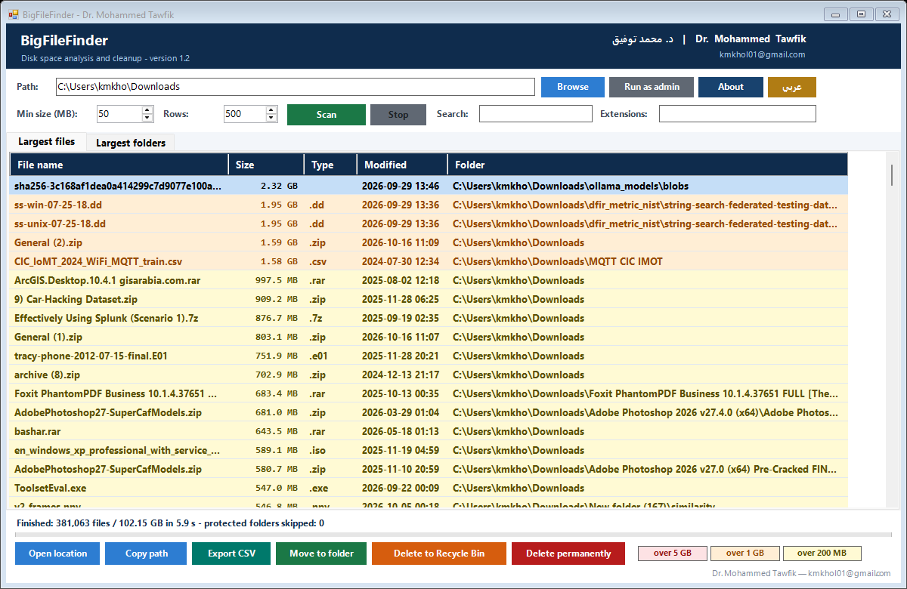
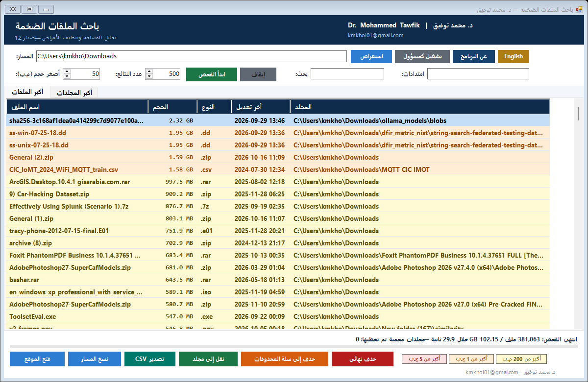

# BigFileFinder — باحث الملفات الضخمة

**Find, inspect and delete the huge files Windows Explorer refuses to show you.**

A single-file, zero-install Windows tool (PowerShell 5.1 + WinForms) that scans any folder
or whole drive, ranks every large file and folder by size, and lets you delete, move or
export them. **Bilingual interface — English and Arabic (right-to-left)**, switched from a
button in the toolbar.

**Author:** Dr. Mohammed Tawfik — د. محمد توفيق · <kmkhol01@gmail.com>



<p align="center"><em>English</em></p>



<p align="center"><em>العربية — same build, one click away</em></p>

---

## Why

Windows Explorer cannot sort a whole drive by file size, and its folder sizes are
unavailable without opening every folder's properties one by one. BigFileFinder walks the
entire tree in seconds and answers the only question that matters: *what is eating my disk?*

- **~380,000 files in ~5 seconds** (measured on an NVMe drive)
- Scan engine is C# injected at runtime, running on a background thread — the window never freezes
- Handles paths longer than 260 characters that Explorer itself cannot open
- Skips symlinks and junctions, so nothing is counted twice and no infinite loops

## Features

| | |
|---|---|
| **Largest files tab** | Every file above your size threshold, with size, type, date and folder |
| **Largest folders tab** | Cumulative size of each folder including everything inside it |
| **Colour tiers** | Rows colour themselves: >5 GB red, >1 GB orange, >200 MB yellow |
| **Real numeric sorting** | Click the Size header — sorts by bytes, not alphabetically |
| **Live filters** | Any text in the path, and an extension list (`mp4;iso;zip`) |
| **Two languages** | English and Arabic RTL; the choice is remembered between runs |
| **Delete to Recycle Bin** | Reversible (`Delete` key) |
| **Permanent delete** | Frees space immediately (`Shift+Delete`), single confirmation |
| **Move to folder** | Archive big research data to another drive instead of deleting it |
| **Export CSV** | Full result set to Excel |
| **Run as administrator** | One click, for `C:\Windows` and other protected trees |

## Install

No installation. Download the folder and double-click:

| File | Does |
|---|---|
| `BigFileFinder.cmd` | Opens the app |
| `فحص مجلد Downloads.cmd` | Opens the app and scans `%USERPROFILE%\Downloads` immediately |

Requires Windows 7 or later with Windows PowerShell 5.1 (preinstalled on Windows 10/11).
The launcher passes `-ExecutionPolicy Bypass`, so no system policy change is needed.

## Language

The interface starts in the language of your Windows installation — Arabic on an Arabic
Windows, English everywhere else. The toolbar button (`عربي` / `English`) switches it and
remembers the choice in `%LOCALAPPDATA%\BigFileFinder\lang.txt`. You can also force it:

```powershell
powershell -ExecutionPolicy Bypass -STA -File BigFileFinder.ps1 -Lang en
```

## Command line

```powershell
# Text mode, no window
powershell -ExecutionPolicy Bypass -File BigFileFinder.ps1 -NoGui -Path "C:\" -MinSizeMB 500 -Top 100 -Csv "D:\report.csv"

# GUI that starts scanning immediately
powershell -ExecutionPolicy Bypass -STA -File BigFileFinder.ps1 -Path "D:\" -MinSizeMB 200 -AutoScan
```

| Parameter | Meaning |
|---|---|
| `-Path` | Folder or drive to scan |
| `-MinSizeMB` | Ignore files smaller than this (default 100) |
| `-Top` | Rows to display (default 500) |
| `-Lang` | `en` or `ar`; omitted, it follows the saved choice then the system language |
| `-Csv` | Write the result to a CSV file (text mode) |
| `-NoGui` | Console output instead of the window |
| `-AutoScan` | Start scanning as soon as the window opens |
| `-SelfTest` | Build the UI headlessly and exit — used by CI |
| `-Shot <file.png>` | Render the window to a PNG — used to verify the layout |

## Notes for contributors

- `BigFileFinder.ps1` **must keep its UTF-8 BOM**, otherwise Windows PowerShell 5.1 mangles
  every Arabic string in the interface.
- All interface text lives in one `Get-Strings` table, one entry per language — adding a
  third language means adding one branch there, nothing else.
- The scanner is a C# class compiled by `Add-Type` at startup; a pure PowerShell loop is
  an order of magnitude too slow for a million files.
- Size columns display a formatted string but sort through a hidden bytes column via
  `SortCompare`.

## License

MIT — see [LICENSE](LICENSE).

---

## بالعربية

أداة ويندوز مستقلة (لا تحتاج تثبيت) تفحص أي مجلد أو قرص كامل وتعرض **أكبر الملفات
والمجلدات مرتّبة تنازلياً**، مع إمكانية حذفها إلى سلة المحذوفات أو حذفها نهائياً أو نقلها
إلى قرص آخر أو تصديرها إلى Excel.

**سبب وجودها:** مستكشف ويندوز لا يستطيع ترتيب قرص كامل حسب حجم الملف، ولا يعرض أحجام
المجلدات إلا بفتح خصائص كل مجلد على حدة.

**التشغيل:** انقر مرتين على `BigFileFinder.cmd`، أو على `فحص مجلد Downloads.cmd` لفحص
مجلد التنزيلات مباشرة. لفحص المجلدات المحمية اضغط زر «تشغيل كمسؤول».

**اللغة:** زر `English` / `عربي` في شريط الأدوات يبدّل لغة الواجهة بالكامل، ويحفظ اختيارك
للمرات القادمة.

**ألوان الصفوف:** أحمر فاتح لما يزيد عن 5 ج.ب، برتقالي لما يزيد عن 1 ج.ب، أصفر لما يزيد
عن 200 م.ب.

للتفاصيل الكاملة انظر ملف [اقرأني.txt](اقرأني.txt).
